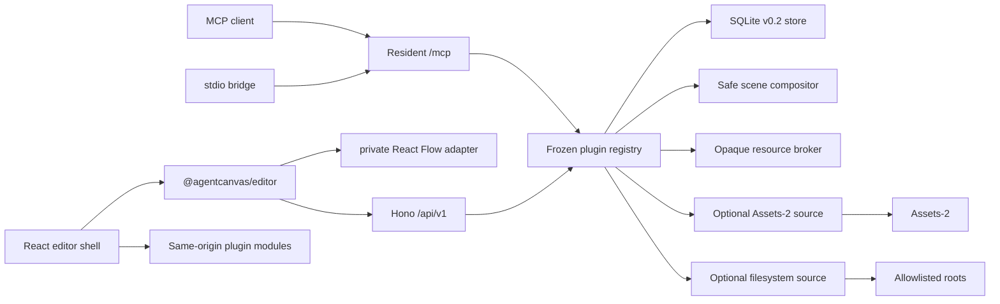

# AgentCanvas architecture

## Product boundary

AgentCanvas is a local-first, single-process visual editor and extension host
for revisioned canvas documents. SQLite owns document state. Optional source
extensions own media references and byte resolution. Normal element
implementations are trusted extensions discovered from `plugins/`.

The kernel does not provide a marketplace, remote loading, production hot
reload, sandboxing, user accounts, or real-time multi-user editing. Short-lived
embed sessions provide origin-scoped iframe authority, not user authentication.

## System map

## Kernel ownership

The root application owns startup ordering, configuration, database versions, canvas CRUD, revisions, idempotency, sharing, viewports, plugin discovery/activation, capability resolution, diagnostics, HTTP/MCP transports, browser framing, snapshot composition, resources, and security headers/origin checks.

`@agentcanvas/core` retains portable kernel canvas contracts.
`@agentcanvas/editor` owns React Flow projection, selection, movement, resize,
viewport conversion, commands, and history primitives. React Flow is private
to that package. Public extension contracts live in
`@agentcanvas/extension-sdk`, which preserves plugin API v1 compatibility
through `@agentcanvas/plugin-sdk`.

## Source ownership

- `src/runtime.ts` constructs and disposes the store, macro runtime, resources and one frozen extension registry.
- `src/api-v2/app.ts` constructs Hono, installs the common Problem Details boundary, and registers host, embed and browser routes. `canvas-routes.ts`, `macro-routes.ts` and `plugin-routes.ts` own their route groups and compile request/response validators during app construction.
- `src/api-v2/core-paths.ts` owns the declarative core OpenAPI paths; `canvas-projection.ts` owns read projections and anchor resolution. `src/server-v2.ts` retains Node HTTP security, resident MCP dispatch and startup, plus its compatibility exports.
- `packages/agent-canvas-core/src/contracts.ts` owns canvas records, operations and batch requests. Store `V2CanvasRecord`/`V2CanvasOperation`/`V2CanvasBatchRequest` and browser `CanvasDocument` remain compatibility aliases. Raw operation data still passes through runtime validation; a TypeScript annotation does not validate JSON.
- `packages/plugin-sdk/src/manifest-schema.ts` owns `PLUGIN_MANIFEST_SCHEMA` and the duplicate-element-name check. The SDK has no Ajv dependency. Runtime and testkit compile this shared structural schema; the runtime additionally checks semver, filesystem containment and installed dependencies.
- `CanvasView` composes presentation, selection, geometry, viewport and diagnostics. `PluginRendererSurface` owns renderer lifetime and context updates. `canvas-clipboard.ts` owns the existing clipboard format and cloning; `canvas-operations.ts` builds forward/inverse operations.
- `use-canvas-history.ts` owns the confirmed document, one mutation queue, one `EditorHistory`, revision reconciliation and macro retry keys. `use-canvas-commands.ts` consumes that owner and registers commands against current canvas, selection and viewport state. It does not maintain a second history or mutation queue.

Renderer context changes update an existing renderer; element identity/type or renderer changes dispose and remount it. The editor's render callback is an explicit projection dependency so runtime-only updates reach mounted renderers without changing node identity.

## Runtime state

- `plugin-packages/`: source workspaces.
- `dist/plugin-catalog/`: generated distributions.
- `plugins/`: active distributions; folder presence is the only enabled-state owner.
- `plugins-disabled/`: disabled distributions retained for manual rollback.
- `data/agent-canvas.sqlite`: SQLite document store.

The default service binds to `127.0.0.1:23003`. Non-loopback binding requires explicit remote access configuration.

## Optional media-source boundary

The host requires no media extension. It provides the singleton `agentcanvas.image-sources@1.0.0` registry so provider extensions can register reference validation and opaque image resolution. `agentcanvas.assets2` and `agentcanvas.filesystem-images` register independent providers; `agentcanvas.gallery` consumes the shared registry without depending on either storage implementation. Assets-2 also optionally provides `agentcanvas.assets@1.0.0` for extensions that need its broader metadata and content contract.

Both sources deliver browser and snapshot bytes through opaque content handles. The host broker applies MIME, byte, TTL, and checksum controls; filesystem policy additionally rejects absolute paths, traversal, symlink escapes, unsupported types, and oversized files.

## Persistence

V0.3 uses physical schema version 4 and document version 2. Physical version 4
adds first-class `theme_json` and host-owned macro storage without changing
element document envelopes. Tables cover canvases, events, share links,
document-versioned idempotency, viewports, configuration, installation
metadata, host migration runs, plugin migration runs, plugin KV, macro
definitions, immutable macro versions, and macro invocations.

Historical v0.1 event bodies are audit records and remain document version 1 after migration. Current canvas documents are canonical version 2 envelopes.

## Public surfaces

- Unversioned: `/health`, `/whoami`, `/openapi.json`, `/mcp`, `/`, `/canvases`, `/canvases/:canvasId`, `/c/:shareToken`, `/embed/:token`.
- JSON API: `/api/v1/...`.
- Browser plugin modules: build-hash-keyed same-origin `/api/v1/plugin-modules/...`.
- Binary resources: opaque `/api/v1/resources/:handle/...`.

See [HTTP and MCP](http-and-mcp.md) for the current public surfaces, [physical
schema 4 migration](physical-schema-4-migration.md) for offline upgrade paths,
and [HTTP/MCP migration mapping](http-mcp-v0.2-mapping.md) for the historical
v0.1 replacement table.
