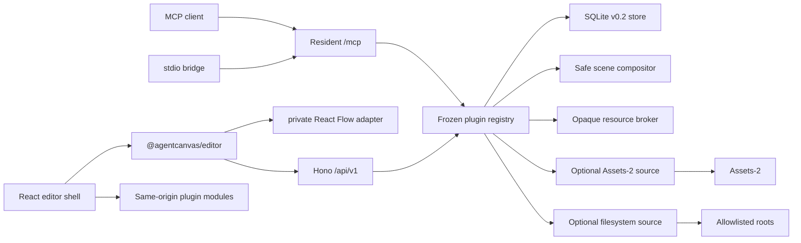

# AgentCanvas architecture

## Product boundary

AgentCanvas is a local-first, single-process visual editor and extension host
for revisioned canvas documents. SQLite owns document state. Optional source
extensions own media references and byte resolution. Normal element
implementations are trusted extensions discovered from `plugins/`.

The kernel does not provide a marketplace, remote loading, production hot
reload, sandboxing, user accounts, or real-time multi-user editing.

## System map

## Kernel ownership

The root application owns startup ordering, configuration, database versions, canvas CRUD, revisions, idempotency, sharing, viewports, plugin discovery/activation, capability resolution, diagnostics, HTTP/MCP transports, browser framing, snapshot composition, resources, and security headers/origin checks.

`@agentcanvas/core` retains portable kernel canvas contracts.
`@agentcanvas/editor` owns React Flow projection, selection, movement, resize,
viewport conversion, commands, and history primitives. React Flow is private
to that package. Public extension contracts live in
`@agentcanvas/extension-sdk`, which preserves plugin API v1 compatibility
through `@agentcanvas/plugin-sdk`.

## Runtime state

- `plugin-packages/`: source workspaces.
- `dist/plugin-catalog/`: generated distributions.
- `plugins/`: active distributions; folder presence is the only enabled-state owner.
- `plugins-disabled/`: disabled distributions retained for manual rollback.
- `data/agent-canvas.sqlite`: SQLite document store.

The default service binds to `127.0.0.1:23003`. Non-loopback binding requires explicit remote access configuration.

## Optional media-source boundary

The host requires no media extension. It provides the singleton `agentcanvas.image-sources@1.0.0` registry so provider extensions can register reference validation and opaque image resolution. `agentcanvas.assets2` and `agentcanvas.filesystem-images` register independent providers; `agentcanvas.gallery` consumes the shared registry without depending on either storage implementation. Assets-2 also optionally provides `agentcanvas.assets@1.0.0` for extensions that need its broader metadata and content contract.

Both sources deliver browser and snapshot bytes through opaque content handles. The host broker applies MIME, byte, TTL, and checksum controls; filesystem policy additionally rejects absolute paths, traversal, symlink escapes, unsupported types, and oversized files.

## Persistence

V0.2 uses physical schema version 3 and document version 2. Physical version 3 adds first-class `theme_json` storage without changing element document envelopes. Tables cover canvases, events, share links, document-versioned idempotency, viewports, configuration, installation metadata, host migration runs, plugin migration runs, and plugin KV.

Historical v0.1 event bodies are audit records and remain document version 1 after migration. Current canvas documents are canonical version 2 envelopes.

## Public surfaces

- Unversioned: `/health`, `/whoami`, `/openapi.json`, `/mcp`, `/`, `/canvases`, `/canvases/:canvasId`, `/c/:shareToken`.
- JSON API: `/api/v1/...`.
- Browser plugin modules: build-hash-keyed same-origin `/api/v1/plugin-modules/...`.
- Binary resources: opaque `/api/v1/resources/:handle/...`.

See [HTTP and MCP](http-and-mcp.md) for the current public surfaces and [HTTP/MCP migration mapping](http-mcp-v0.2-mapping.md) for the historical v0.1 replacement table.
