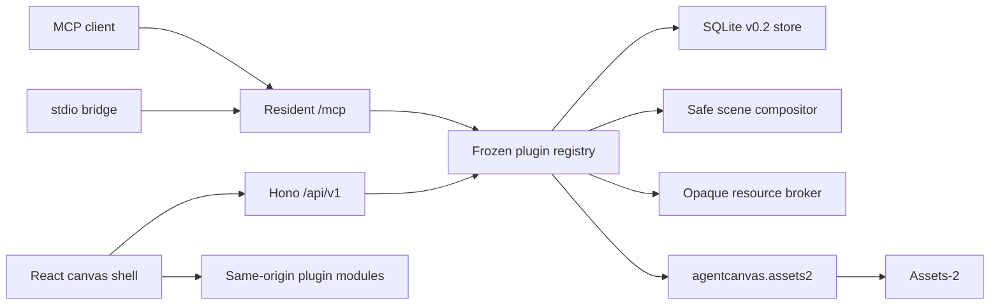

# AgentCanvas v0.2 architecture

## Product boundary

AgentCanvas is a local-first, single-process plugin host for revisioned visual canvas documents. SQLite owns document state. Assets-2 owns durable media identity and bytes. Normal element implementations are trusted plugins discovered from the installation's `plugins/` folder.

The kernel does not provide a plugin marketplace, remote loading, hot reload, sandboxing, user accounts, or real-time multi-user editing.

## System map

## Kernel ownership

The root application owns startup ordering, configuration, database versions, canvas CRUD, revisions, idempotency, sharing, viewports, plugin discovery/activation, capability resolution, diagnostics, HTTP/MCP transports, browser framing, snapshot composition, resources, and security headers/origin checks.

`@agentcanvas/core` retains portable kernel canvas contracts. Public generic plugin contracts live in `@agentcanvas/plugin-sdk`. First-party plugins may not import root-private modules.

## Runtime state

- `plugin-packages/`: source workspaces.
- `dist/plugin-catalog/`: generated distributions.
- `plugins/`: active distributions; folder presence is the only enabled-state owner.
- `plugins-disabled/`: disabled distributions retained for manual rollback.
- `data/agent-canvas.sqlite`: SQLite document store.

The default service binds to `127.0.0.1:23003`. Non-loopback binding requires explicit remote access configuration.

## Required Assets boundary

The host requires `agentcanvas.assets@^1.0.0`. `agentcanvas.assets2` provides it and verifies that Assets-2 is healthy, identifies as `asset-service`, and advertises `asset_crud` and `asset_refs`. Startup fails without readiness; runtime `/health` returns 503 when readiness fails.

Assets are exposed to plugins as validated refs, safe details, bounded JSON content, and opaque content handles. The host broker applies MIME, byte, TTL, and checksum controls.

## Persistence

V0.2 uses physical schema version 2 and document version 2. Tables cover canvases, events, share links, document-versioned idempotency, viewports, configuration, installation metadata, host migration runs, plugin migration runs, and plugin KV.

Historical v0.1 event bodies are audit records and remain document version 1 after migration. Current canvas documents are canonical version 2 envelopes.

## Public surfaces

- Unversioned: `/health`, `/whoami`, `/openapi.json`, `/mcp`, `/`, `/canvases`, `/canvases/:canvasId`, `/c/:shareToken`.
- JSON API: `/api/v1/...`.
- Browser plugin modules: build-hash-keyed same-origin `/api/v1/plugin-modules/...`.
- Binary resources: opaque `/api/v1/resources/:handle/...`.

See [HTTP and MCP](http-and-mcp.md) for the current public surfaces and [HTTP/MCP migration mapping](http-mcp-v0.2-mapping.md) for the historical v0.1 replacement table.
