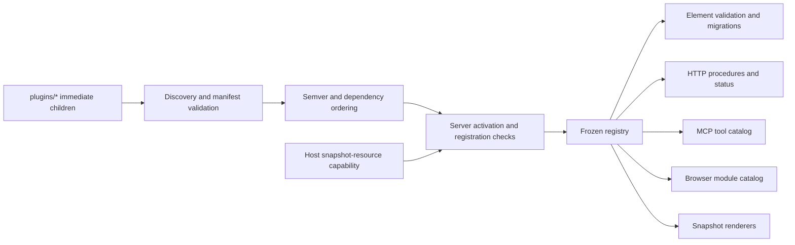

# AgentCanvas v0.2 plugin architecture and migration

Status: implemented v0.2 runtime contract and completed reference-deployment cutover.

## Architecture

AgentCanvas v0.2 has one stable kernel and one frozen plugin registry per process start.



The kernel owns canvas/document semantics. Plugins own normal element schemas, summaries, optional read projections, browser renderers, snapshot contributions, tools, procedures, legacy importers, and optional capabilities.

## Activation source of truth

There is no enabled-plugin list and no `agentcanvas.config.mjs`. Every non-hidden, non-`node_modules` immediate child directory of `plugins/` is considered active. Discovery is deterministic and non-recursive. Restart is required after filesystem changes.

The runtime resolves `plugins/` relative to the installed AgentCanvas source, not the process working directory. A plugin root must be a direct real directory; root symlinks are rejected. Declared files are resolved through real paths and must remain inside the plugin root.

## Startup lifecycle

Current startup performs these phases:

1. Load environment and host configuration.
2. Discover and validate visible plugin directories.
3. Validate host API, plugin dependencies, capability ranges, singleton providers, normalized tool names, and cycles.
4. Activate server entries in dependency order.
5. Check that actual elements, tools, procedures, migrations, and provided capabilities exactly match the manifest.
6. Freeze the registry.
7. Open or initialize the SQLite database and require physical/document version 2.
8. Bind plugin KV to the database.
9. Require `agentcanvas.assets@^1.0.0` and run its readiness probe.
10. Build the browser catalog and runtime OpenAPI.
11. Begin listening.

The host supplies `agentcanvas.snapshot-resources@1.0.0` before plugin activation. The Assets-2 plugin supplies the required Assets capability.

### Installed-plugin schema readiness

Startup inspects stored element schema versions after the registry and v0.2 database are loaded. A pending contiguous migration fails readiness with the exact offline CLI command; future or unbridgeable versions fail explicitly. `npm run migrate -- apply ...` backs up and applies pure forward steps transactionally and records `plugin_migration_runs`.

## Trust and permissions

Plugins are trusted executable application dependencies. Server entries run Node.js in-process. Browser entries execute same-origin JavaScript. Shadow DOM isolates lifecycle and styling, not authority.

Manifest permissions appear in safe status output and gate supported canvas host operations. Capability consumption is limited to exact manifest requirements. These controls define the supported API, not a sandbox against trusted Node or same-origin browser code. See [Capabilities and permissions](plugin-capabilities-and-permissions.md).

## Stable element envelope

```ts
interface CanvasElement<TData extends JsonObject = JsonObject> {
  id: string;
  type: `${string}/${string}`;
  schemaVersion: number;
  x: number;
  y: number;
  width?: number | null;
  height?: number | null;
  zIndex?: number | null;
  rotation?: number | null;
  opacity?: number | null;
  locked?: boolean | null;
  style?: JsonObject | null;
  metadata?: JsonObject;
  data: TData;
}
```

The kernel validates the envelope and finite JSON. The owning plugin validates `data`, optional `style`, and cross-field rules. Normal mutations cannot change `id`, `type`, or `schemaVersion`. Type changes are delete plus upsert. Schema-version changes belong to migrations.

When the owning optional plugin is absent, canonical data is preserved. Frame patches, metadata replacement, deletion, and clear remain available. Upsert and data/style replacement fail with `plugin_unavailable`.

## Registration model

Server entrypoints default-export an object with `activate(host)`. The host records registrations during activation and rejects missing, undeclared, duplicate, or mismatched contributions. Capability providers are singleton and semantically versioned.

The registry object and activated descriptors are deeply frozen. HTTP, MCP, browser catalog generation, snapshot lookup, and store validation receive that same registry instance.

## Browser and snapshot boundary

Browser plugins register framework-neutral renderers. The host owns the outer frame, transforms, movement, selection, read-only state, geometry service, overlays, abort signals, and error cards. See [Browser plugin runtime](plugin-browser-runtime.md).

Snapshot plugins return a bounded typed scene. They never return raw SVG, HTML, CSS, URLs, or data URLs. The kernel validates and serializes the scene and resolves only opaque resource handles. See [Snapshot plugin runtime](plugin-snapshot-runtime.md).

## HTTP, MCP, and OpenAPI

JSON document routes live under `/api/v1`. Plugin procedures use one host-owned route shape and 30-second deadline. MCP plugin tools use the same descriptor JSON Schemas. Stdio is a transport bridge to resident `/mcp`; it does not rediscover plugins.

Runtime `/openapi.json` is registry-derived. Core routes, active plugin procedures, element schemas, diagnostics, and resource handles are composed from the frozen registry and documented in [HTTP and MCP](http-and-mcp.md). The [migration mapping](http-mcp-v0.2-mapping.md) records removed v0.1 surfaces.

## Packaging and activation workflow

First-party source, catalog distributions, and active runtime state are deliberately separate:

```text
plugin-packages/*
dist/plugin-catalog/*
plugins/*
```

Catalog construction copies only manifest, built `dist/`, optional README/license/config, and schemas. Installation validates the source, copies it into a hidden staging directory, revalidates identity/version, and renames the stage into place. Replacement is intentionally not implicit: disable the existing version, then install the replacement while AgentCanvas is stopped.

## Document migration

The v0.1→v0.2 migration is offline and transactional. The host identifies each legacy type, calls the owning plugin's pure importer twice to prove deterministic output, validates the canonical envelope and active plugin schema, then updates all documents in one exclusive transaction.

Unknown types, unexpected fields, malformed JSON, duplicate IDs, missing importers, and any `group` record block migration. Runtime-only response fields are counted and stripped. Historical event JSON remains unchanged and is marked document version 1. Old idempotency responses are cleared.

See [v0.1 to v0.2 migration](v0.1-to-v0.2-migration.md) for operator commands and database-specific verification requirements.

## Activation and migration status

The reference installation was cut over on 2026-07-13. Its physical/document version 2 database passed migration, integrity, HTTP, MCP, snapshot, resource, and production-browser acceptance. Installation-specific plugin choices, counts, and backup records remain private operator evidence; every new migration must be verified against its own preflight report.
