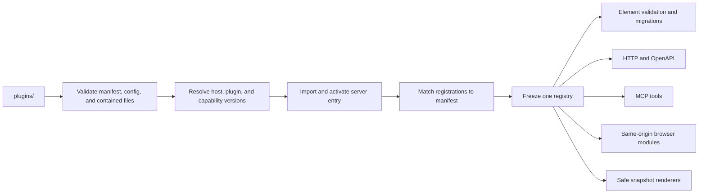

# How plugins work

AgentCanvas core is a stable canvas/document host. Plugins supply normal element behavior and optional domain features through public contracts.

## The lifecycle



The registry is built once at service startup. Adding, removing, or changing a plugin requires a restart.

## Activation is folder presence

```text
plugins/
  acme.signal-card/
    agentcanvas.plugin.json
    plugin.config.json
    schemas/config.schema.json
    dist/server.mjs
    dist/browser/entry.mjs
```

Every non-hidden immediate child directory is active. Discovery is deterministic and non-recursive. There is no `agentcanvas.config.mjs`, enabled-plugin array, database activation flag, hot reload, remote loader, marketplace, or browser upload.

An invalid visible folder fails startup. AgentCanvas never silently skips it.

## What a plugin can contribute

| Contribution | Purpose |
|---|---|
| Element type | Owns current schema, validation, summary, runtime resolution, browser policy, and snapshot policy |
| Browser renderer | Renders plugin content inside a host-supplied ShadowRoot |
| Snapshot renderer | Returns bounded typed scene nodes, never raw SVG/HTML/CSS |
| MCP tool | Gives agents a domain-specific, schema-validated operation |
| HTTP procedure | Exposes a schema-validated plugin operation through the host route |
| Migration | Imports legacy shapes or advances owned element schema versions |
| Capability provider | Supplies a singleton semantic-versioned service to declared consumers |

Plugins cannot register arbitrary Hono routes or middleware through the SDK. They do not receive SQLite, private React components, raw authentication values, or unrestricted host fetch/filesystem helpers.

## Manifest first, registration second

`agentcanvas.plugin.json` declares identity, compatibility, permissions, entrypoints, contributions, and optional configuration.

The server entry activates and registers descriptors. Actual registrations must exactly match the manifest. This prevents code and metadata from drifting across HTTP, MCP, browser, OpenAPI, and migration surfaces.

Persisted element types are derived as `<plugin-id>/<local-element-name>`. MCP tool names are derived as `<normalized-plugin-id>__<normalized-local-tool-name>`.

## Server and browser entries

The required server entry is prebuilt ESM and default-exports `AgentCanvasServerPlugin`. It registers schemas and behavior against `ServerPluginHost`.

The optional browser entry is also prebuilt ESM. It is delivered from a same-origin, build-hash URL. It must be self-contained within its declared browser subtree and default-export `AgentCanvasBrowserPlugin`.

Browser plugins are framework-neutral from the host's perspective. They may bundle their own framework, but may not import the host React runtime or private components.

## Who owns an element

The kernel owns the stable envelope: ID, namespaced type, schema version, frame, optional style/metadata, and JSON data.

The plugin owns:

- the schema and meaning of `data`;
- the schema and meaning of non-null `style`;
- cross-field validation;
- summaries and runtime resolution;
- browser and snapshot content;
- forward schema migrations.

Host frame fields are not plugin style. Normal patches cannot change ID, type, or schema version.

## What happens when a plugin is absent

Optional-plugin removal is data-preserving:

- Reads keep the complete canonical envelope.
- The host adds an explicit missing-plugin diagnostic.
- Frame and metadata edits, deletion, and clear still work.
- Data/style changes and upserts for that type fail with `plugin_unavailable`.
- Reinstalling a compatible plugin restores validation and rendering without rewriting the document.

AgentCanvas never silently deletes, downgrades, or converts the element to a generic fallback.

## Capabilities and required Assets-2

Capabilities are singleton providers with semantic versions. Consumers declare a required range in the manifest and may consume only that declaration.

The standard host requires `agentcanvas.assets@^1.0.0`. The default `agentcanvas.assets2` plugin provides it and verifies Assets-2 health, exact identity, and required capabilities before the host listens. This plugin is therefore required even though the integration uses the same public capability system available to third parties.

## Trust and security

Plugins are trusted executable application dependencies:

- Server code executes in the AgentCanvas Node process.
- Browser code executes same-origin in the AgentCanvas page.
- Permissions constrain the supported host API, not arbitrary code execution.
- Shadow DOM provides styling and lifecycle isolation, not a security sandbox.

Review plugin code and distribution contents before installation. Do not install untrusted plugins.

## First-party distribution

Default activation:

- `agentcanvas.primitives`
- `agentcanvas.markdown`
- `agentcanvas.table`
- `agentcanvas.assets2`

Built but optional by default:

- `agentcanvas.image-overlays`
- `agentcanvas.video`
- `agentcanvas.glb-viewer`

First-party source lives in `plugin-packages/`; built distributions live in `dist/plugin-catalog/`; active copies live in `plugins/`.

## Next steps

- Create one: [Plugin authoring](plugin-authoring/README.md)
- Follow the example: [Build your first plugin](plugin-authoring/tutorial.md)
- Install or replace one: [Operations](operations.md)
- Read exact fields: [Manifest reference](plugin-manifest-reference.md)
- Read exact interfaces: [Plugin API reference](plugin-api-reference.md)
